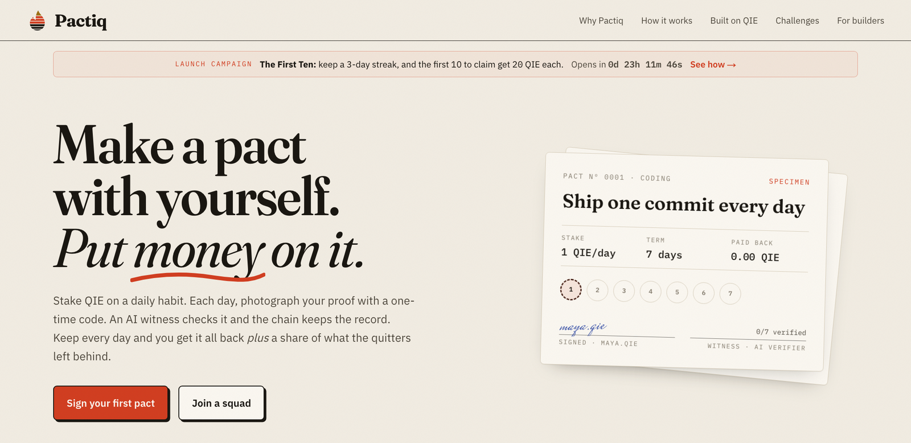
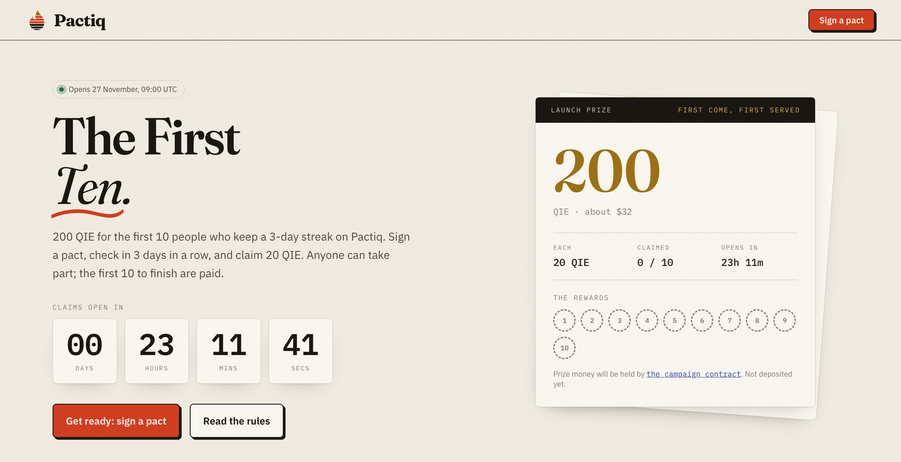
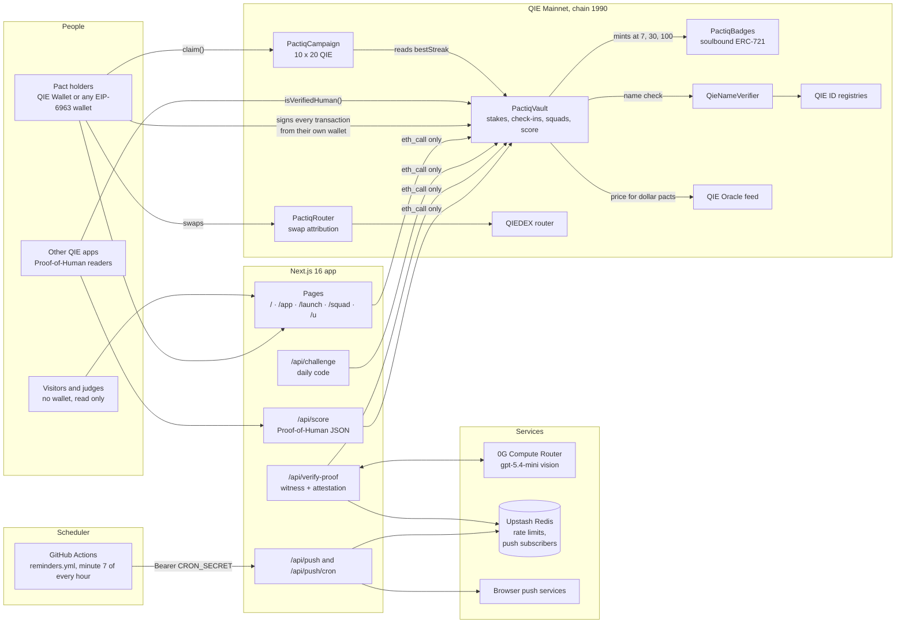
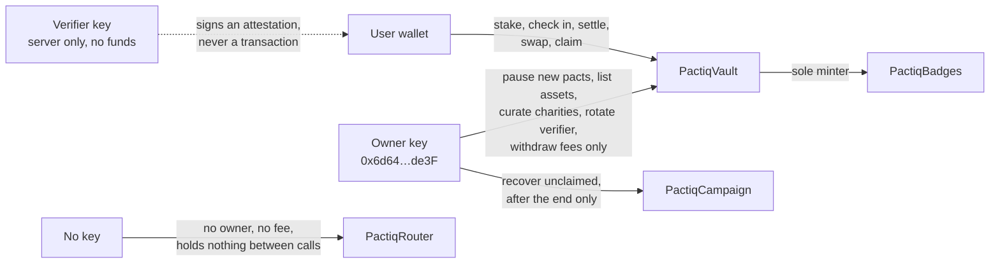
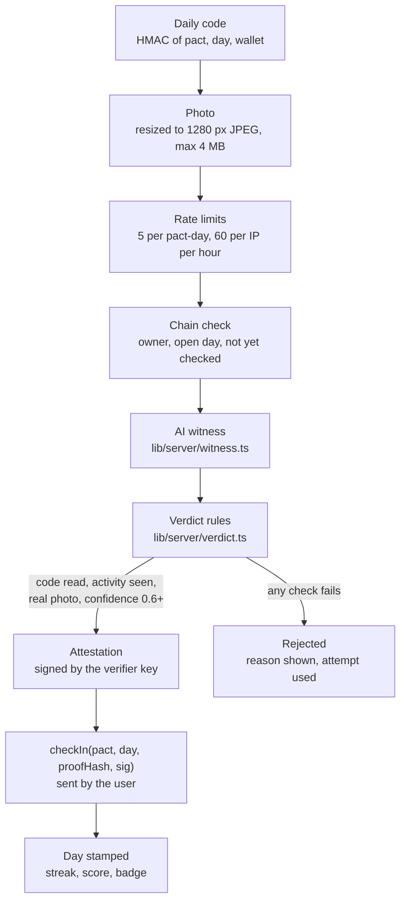
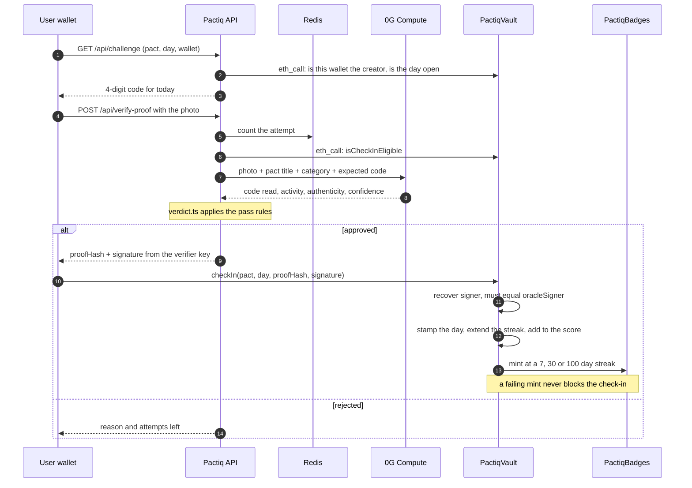
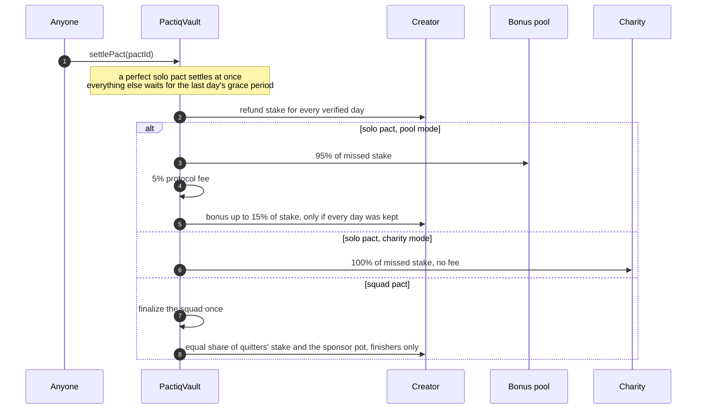
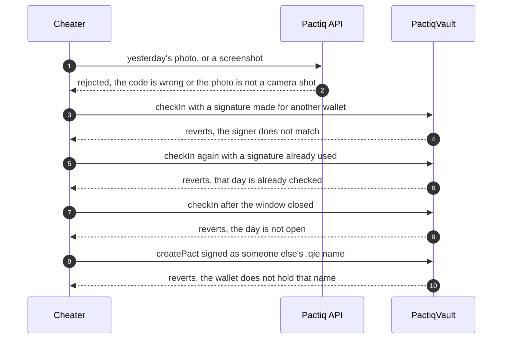
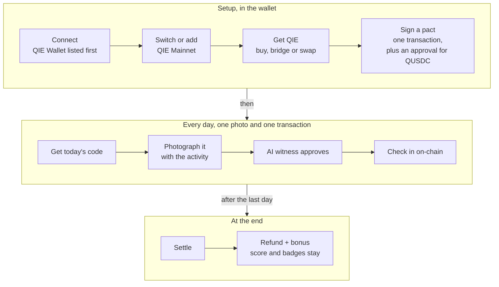

# Pactiq

**Stake money on a daily habit, prove each day with a photo an AI witness checks, and get every kept day back.**

Pactiq is a habit-staking app on QIE Mainnet. You lock QIE or QUSDC (QIE's dollar stablecoin) on a habit for 3 to 100 days. Each day you photograph yourself doing it next to a one-time code, an AI vision model judges the photo, and the check-in is written on-chain. Everything is measured by one number: **verified days kept**. A kept day is refunded, a missed day is forfeited, and a wallet's kept days become a public Proof-of-Human score any other QIE app can read.

Built for QIE Blockchain Hackathon 3.0 · Track: Consumer Apps & Social · App: [usepactiq.vercel.app](https://usepactiq.vercel.app) · Demo: [youtu.be/8vis5Cyfam0](https://youtu.be/8vis5Cyfam0) · Code: [github.com/mrnetwork0001/Pactiq](https://github.com/mrnetwork0001/Pactiq) (public)

**Judges, start here:** [usepactiq.vercel.app](https://usepactiq.vercel.app) reads live numbers straight from the vault with no wallet, and [/launch](https://usepactiq.vercel.app/launch) shows the launch campaign's contract state. To see a full pact lifecycle (stake, daily check-ins, settlement, badges) without spending anything, run the [one-command demo](#run-it-locally), which replays about 9 days of activity on a local fork of QIE Mainnet. All five contracts are source-verified on the QIE explorer: start with the vault, [`0xcc8c…Be3B`](https://mainnet.qie.digital/address/0xcc8cb1Ae278dbc5077A8c0aB7517F1278C84Be3B).





<sub>Screenshots of the live app, taken Nov 26 2026. The pact card on the landing page is a specimen.</sub>

---

## Four steps, and what you can see with no wallet

| Step | What it is | Try it without a wallet |
| --- | --- | --- |
| **Sign** | A pact is a title, a category, a stake per day and a length of 3 to 100 days, signed with your wallet and optionally your `.qie` name. Stake in QIE (minimum 0.01 per day), in QUSDC (minimum 0.10 per day), or in dollars: `createPactUsd` prices the QIE amount on-chain from the QIE Oracle, rejects a price older than 1 day and refunds any overpayment in the same transaction. | `/` shows every recent pact in the ticker and the totals locked. The form is at `/app#new` (signing needs a wallet). |
| **Prove** | Each day the server issues a 4-digit code that is an HMAC (a keyed hash) of the pact, the day and the wallet. You write it down, photograph it with your activity, and a vision model on the 0G Compute Router must read the exact code, see the right activity and judge the photo to be a real camera shot, with confidence of at least 0.6. Only then does the server sign an attestation the contract accepts. *The model decides whether you did it. The contract decides whether that decision counts.* | The rules and the daily window are explained on `/` under "How it works". Checking in needs a wallet and an open day. |
| **Settle** | When the pact ends, every verified day's stake is refunded. Missed days are forfeited: 5% is a protocol fee and 95% goes to that currency's bonus pool, or 100% goes to a charity if you chose one. Finishing every day earns a bonus of up to 15% of your stake from the pool. | `/` shows the bonus pool (50 QIE on Nov 23 2026) and what has been paid out. |
| **Vouch** | Every wallet has a public score: 10 per check-in, 100 per completed pact, 20 per day of best streak, minus 50 per failed pact. Other contracts call `isVerifiedHuman(user, minScore)`; other apps call one HTTP endpoint. Streaks of 7, 30 and 100 days mint a soulbound badge. | `GET /api/score/<address>?min=200` returns JSON for any address. `/u/<address>` is the public profile. `/app#register` is the leaderboard. |

### More to explore

| Feature | What it is | Where |
| --- | --- | --- |
| **Squads** | Friends commit to the same habit, stake and start time (up to 100 members, joinable until 12 hours after the start). A quitter's forfeited stake is split between the squad's finishers. | `/app#squads`, invite link `/squad/<id>` (squad 1 exists on mainnet) |
| **Sponsored challenges** | Anyone can add a prize pot to a squad with `sponsorSquad`. It is split equally between finishers; if nobody finishes it goes to the bonus pool. | `/app#squads` |
| **Built-in swap** | QIE ⇄ QUSDC on QIEDEX from inside the app, at 1% maximum slippage, with a progress window for each wallet confirmation. In the pact form, a top-up quotes the exact QUSDC shortfall and buys it in one transaction. Every swap goes through `PactiqRouter`, which emits `PactiqSwap` and keeps running totals. No Pactiq fee. | `/app#swap` |
| **Verified names (QIE ID)** | A `.qie` name on a pact is checked on-chain against QIE's two name registries and reverse resolver, so nobody can sign as someone else. The header shows the connected wallet's `.qie` name instead of its address. | Pact form, header |
| **Charity mode** | Missed stakes go 100%, with no fee, to a cause from an owner-curated list. Anyone can trigger the payout with `releaseCharity`. The mainnet list is empty today. | Pact form |
| **Launch campaign: The First Ten** | A separate contract pays 20 QIE to each of the first 10 wallets that claim with a best streak of 3 days or more, between Nov 27 2026 09:00 UTC and Nov 30 2026 00:00 UTC, or until all 10 are claimed. The page counts down to the opening, then to the deadline. | `/launch` |
| **Reminders** | Web push when a check-in is about to close, calendar (`.ics`) files per pact, and an installable app (web manifest and service worker). | `/app` → More, `/api/reminder/<pactId>` |
| **Share cards** | Generated images for profiles and squads, with one-tap posting to X and Telegram. | `/api/card`, `/u/<address>`, `/squad/<id>` |
| **Get QIE** | Links to buy QIE and to the QIE bridge for wallets that arrive empty. | `/app` |
| **Terms and privacy** | Plain-language terms of use and privacy notice. | `/terms`, `/privacy` |

The app is drawn as paper, not as a dashboard. A pact is a contract sheet with numbered clauses, your name as an ink signature, a row of stamps for the days you kept and a **KEPT** or **BROKEN** stamp at the end; badges are wax seals and the leaderboard is a register. On phones `/app` becomes a five-tab shell (Today, Pacts, Squads, Ranks, More) with a bottom bar. **Connect** discovers wallets through EIP-6963 (the standard by which browser wallets announce themselves), lists QIE Wallet first, and switches the wallet to QIE Mainnet or offers to add the network. Every transaction opens the same progress window: one row per wallet confirmation, the explorer link once it is sent, and a plain success or failure message.

## Why the chain is essential

- **No contract, no stake.** The money is held by `PactiqVault`, not by Pactiq. The owner key can withdraw only accrued protocol fees (`withdrawProtocolFees` in `contracts/src/PactiqVault.sol`); fuzz tests assert the vault's balance always covers active stakes, bonus pools, fees, squad escrow and charity escrow.
- **No signature, no check-in.** `checkIn` recovers the signer of `keccak(vault, chainId, pact, day, proofHash, user)` and requires it to be the vault's `oracleSigner`. An attestation works once, for one wallet, one pact and one day, on this contract and this chain.
- **No on-chain price, no dollar pact.** `createPactUsd` reads the QIE Oracle feed inside the transaction and refuses a stale price, so the dollar amount is not a number the frontend made up.
- **No registry, no name.** `QieNameVerifier` (`contracts/src/QieNameVerifier.sol`) asks QIE's own registries whether the signing wallet holds the `.qie` name. The vault reverts if it does not.
- **No record, no reputation.** The score is a pure function of counters the vault updates on check-in and settlement (`getHumanProfile`). Nothing off-chain can raise it.

## Architecture

Pactiq has four layers:
- **The chain:** QIE Mainnet holds the vault, the badges, the swap router, the name verifier and the campaign.
- **The app:** one Next.js app serves every page and API route.
- **The services:** the 0G Compute Router runs the vision model, and Upstash Redis keeps rate limits and reminder subscriptions.
- **The scheduler:** a GitHub Actions workflow calls the reminder route once an hour.

### System overview



**The server never sends a transaction.** Every route that touches the chain only reads it. The one secret that matters to the contract, the verifier key, signs a message that the user then submits from their own wallet, so the server holds no funds and needs no gas.

**State.** Everything that matters is on-chain. Redis holds only rate-limit counters and push subscriptions; without it both fall back to server memory, which suits a laptop but not a serverless host (`frontend/src/lib/server/store.ts`).

**Scheduling.** `GET /api/push/cron?within=4` sends a reminder for every subscribed pact whose open check-in closes within 4 hours. `.github/workflows/reminders.yml` calls it at minute 7 of every hour with a Bearer secret, and skips quietly until its two repository secrets are set.

### Who holds which key



| Key | Lives in | Can | Can never |
| --- | --- | --- | --- |
| User wallet | The user's own wallet | Create, join, sponsor, check in on its own pacts, settle, swap, claim a campaign reward | Check in on someone else's pact, or reuse an attestation |
| Verifier key (`oracleSigner`, [`0x3826…1838`](https://mainnet.qie.digital/address/0x3826Bb23C453DA1D18b96dDCB1dCF9D7988a1838)) | Server environment only; holds no QIE | Sign that one wallet kept one day of one pact | Move funds, send transactions, or approve a day outside its window. If it leaked, an attacker could approve their own check-ins (refunding their own stake and earning up to 15% from the pool) but could not take anyone else's stake. The owner rotates it with `setOracleSigner`. |
| Owner ([`0x6d64…de3F`](https://mainnet.qie.digital/address/0x6d64eE62738f462121a66C3a23E0210b708bde3F)) | Deployer wallet | Pause new pacts and squads, list stake assets, curate charities, set the price feed, badges and name verifier, rotate the verifier key, withdraw accrued protocol fees | Touch user stakes, bonus pools, squad pots or charity balances, or block check-ins and settlements (pausing does not stop them). Ownership transfer takes two steps. |
| Campaign owner (same wallet) | Deployer wallet | Recover unclaimed prize money after the end, or once all 10 are claimed | Change the reward, the winners, the streak or the dates (all immutable), or withdraw while claims are open |
| `CRON_SECRET` | Host and scheduler | Trigger the reminder run | Anything on-chain |

### From photo to kept day



The model's answer is not trusted as given. `verdict.ts` re-checks the digits the model says it read against the expected code, clamps the confidence, and approves only when all four conditions hold. Text inside the image is treated as data, never as instructions to the model.

### One check-in, end to end



Day N's window opens at `start + (N-1) days` and closes 12 hours after that day ends, to allow for time zones. Miss it and that day's stake is forfeited at settlement.

### Settlement: where the money goes



The bonus is paid first come, first served from the pool as it stands, so the app labels the figure as an estimate. QIE and QUSDC keep separate ledgers for stakes, pools, fees, squad pots and charity balances; one score spans both.

### What the contract refuses



### Getting started as a user



### A real example

The vault was deployed on Nov 23 2026 at 07:48 UTC ([transaction](https://mainnet.qie.digital/tx/0xb8d69dd957ee3df498b4f40821970edbbcfdc5445ae1fff667720a274beb4396), block 12,109,737) and its bonus pool was seeded with 50 QIE a minute later ([transaction](https://mainnet.qie.digital/tx/0x715b1aa43b84ba750dcb411776ddb22e0e8c4ba0e65e775086c36cc44595d57f)). The same day, a dollar-priced pact was created through the on-chain oracle ([`createPactUsd`](https://mainnet.qie.digital/tx/0x73a766b566f8bb37674842135431f20a3f1e2bdc0937c02c59dc0d6fccdd5f03)), QIE was swapped for QUSDC through the router ([`swapQieForToken`](https://mainnet.qie.digital/tx/0xeb8953313db45a6434a96c912ae98a0dce2056977524a6e6617a313e4dc041dc)) and staked, and a squad was created, joined and sponsored ([`sponsorSquad`](https://mainnet.qie.digital/tx/0x07e7dd009d0fa2d9320c06ff7b2c786d83d6243cabb42c94e163167c87272b68)).

Read from the chain on Nov 26 2026 (unchanged since Nov 23): 5 pacts, 1 squad, 2.29 QIE and 0.70 QUSDC in active stakes, 50 QIE in the bonus pool, and 4 swaps worth 8.65 QIE through the router. **No check-in has been recorded on mainnet yet**, so no pact has settled and no badge exists there; four of the five pacts are the team's own test pacts.

## Safety

- **The owner cannot take user money.** `withdrawProtocolFees` pays out only the fee counter of one currency. Stakes, bonus pools, squad escrow and charity escrow have no owner path out. Fuzz tests (512 runs each) check `balance ≥ active + pool + fees + squad escrow + charity escrow` across random sequences, for QIE and for mixed QIE and QUSDC.
- **Pausing cannot trap funds.** `pause()` blocks `createPact`, `createPactUsd`, `createSquad` and `joinSquad` only. Check-ins and settlements always work.
- **Hard limits in the contract:** 3 to 100 days, an 80-character title, 100 squad members, a squad start at most 14 days ahead, a 12-hour grace period, a 5% fee on forfeited stake, a 15% bonus ceiling, and a price no older than 1 day for dollar pacts.
- **The verifier key signs, it never spends.** It holds no QIE and sends nothing. Each attestation is bound to the contract address, chain id, pact, day, proof hash and wallet.
- **The AI is boxed in.** It returns four fields; `verdict.ts` decides. The expected code is compared digit for digit. There are 5 attempts per pact-day and 60 per IP per hour, counted in Redis and failing open if Redis is down so an outage cannot cost a user a day. Photos are capped at 4 MB.
- **The demo verifier cannot run on mainnet.** `PACTIQ_DEMO_VERIFIER=true` approves any photo for local demos, and `demoVerifierEnabled()` returns false whenever the network is mainnet (`frontend/src/lib/server/verifier.ts`).
- **Swaps leave nothing behind.** `PactiqRouter` has no owner and no fee, forwards proceeds straight to the user and holds no balance or allowance between calls; its tests assert both. The app applies 1% maximum slippage and a deadline.
- **Token safety.** QUSDC is approved for exactly the amount a pact needs. Fee-on-transfer tokens are refused at deposit. Only the owner lists stake assets.
- **The campaign is fixed at deployment.** Reward, winner count, streak and dates are immutable. The contract pays only what it holds, one reward per wallet.
- **Push subscriptions are restricted.** `parseSubscription` accepts endpoints only on known browser push hosts, so the server cannot be pointed at an arbitrary URL.
- **Tests:** 79 Foundry tests pass and 3 more run against live QIE Mainnet state (see [Run it locally](#run-it-locally)). Continuous integration runs `forge fmt --check`, `forge build --sizes`, `forge test`, and the frontend's lint, typecheck, tests and build on every push (`.github/workflows/ci.yml`).

## What's real and what isn't yet

| Real | Simulated, or not live yet |
| --- | --- |
| Five contracts deployed and source-verified on QIE Mainnet (chain 1990) | The app flows in the demo video were recorded on the local demo chain (labelled on screen) |
| Stakes in QIE and QUSDC held by the vault, and the 50 QIE bonus pool | The local demo chain: a fork of mainnet with about 9 days of replayed activity and a verifier that approves any photo |
| Dollar pacts priced by the QIE Oracle inside the transaction | The pact card in the landing page hero (marked "Specimen") is an illustration |
| QIE ⇄ QUSDC swaps on QIEDEX, attributed through `PactiqRouter` | The bonus shown before settlement is an estimate at today's pool size |
| `.qie` names checked against QIE's registries | No verified check-in, settlement or badge exists on mainnet yet (Nov 26 2026) |
| AI verdicts from a real vision model on the 0G Compute Router | The AI witness has not yet been scored on a set of real check-in photos (`pnpm witness:eval` exists for that) |
| The hosted app at [usepactiq.vercel.app](https://usepactiq.vercel.app), with totals, ticker, squads and register read from the chain | Push reminders are built and tested locally, not yet delivered from a hosted deployment |
| The launch campaign contract and its immutable terms | The campaign holds 0 QIE until its 200 QIE prize is deposited; the page says "Not deposited yet" |
| | No charity is listed on mainnet |

## Tech stack

Next.js 16.4 (App Router, Turbopack), React 19.3, Tailwind CSS 4.3, viem 2.57, lucide-react, web-push 4, the 0G Compute Router (OpenAI-compatible, `gpt-5.4-mini` by default, with Google Gemini as a fallback), Upstash Redis over REST, Foundry 1.7 with Solidity 0.8.24 on the Shanghai EVM, OpenZeppelin Contracts 5.7, QIEDEX (a Uniswap v2-style router), the QIE Oracle price feed, QIE ID name registries, QIE Mainnet (chain 1990), GitHub Actions, pnpm 9.

## Run it locally

Prerequisites: Node 20 or newer (continuous integration uses Node 24), pnpm 9, and [Foundry](https://getfoundry.sh) (`forge`, `cast`, `anvil`).

**One-command demo, no real funds.** This forks QIE Mainnet from about 9.5 days ago, deploys the contracts, and replays pacts, a sponsored squad, badges and a charity donation so the history ends today.

```bash
# 1. Fork QIE Mainnet
anvil --fork-url https://rpc1mainnet.qie.digital/ --chain-id 1983 \
  --fork-block-number $(( $(cast block-number --rpc-url https://rpc1mainnet.qie.digital/) - 222000 )) &

# 2. A verifier key for the frontend (it needs no funds)
cd frontend && cp .env.example .env.local
cast wallet new              # put the private key in .env.local as ORACLE_PRIVATE_KEY

# 3. Deploy, seed and start (writes the contract address, RPC and demo verifier into .env.local)
pnpm install && pnpm demo:local && pnpm dev
```

Import the demo wallet the script prints (anvil account #1, "maya.qie", a public test key) into your wallet, add the network `http://127.0.0.1:8545` with chain id 1983, and open http://localhost:3000. Today's check-in is open on her meditation pact.

**Against mainnet, read only.** Set the public variables below to the deployed addresses and run `pnpm dev`. Every page loads with no secrets; check-ins need `ORACLE_PRIVATE_KEY` to match the vault's `oracleSigner`, which only the team's deployment has.

| Variable | What it does |
| --- | --- |
| `NEXT_PUBLIC_QIE_NETWORK` | `mainnet` (chain 1990) or `testnet` (chain 1983, also used for the local fork). |
| `NEXT_PUBLIC_PACTIQ_CONTRACT_ADDRESS` | The vault. Mainnet: `0xcc8cb1Ae278dbc5077A8c0aB7517F1278C84Be3B`. |
| `NEXT_PUBLIC_PACTIQ_ROUTER_ADDRESS` | The swap router. Mainnet: `0x5302338570D5565bEf50bdEa64Ce992b54DF96C4`. Unset means swaps trade on QIEDEX directly, without attribution. |
| `NEXT_PUBLIC_CAMPAIGN_ADDRESS` | The launch campaign. Mainnet: `0xA394F027F6Fe27F61C0b5243c8ddF0e653AA9641`. Unset means `/launch` shows the planned terms as a preview. |
| `NEXT_PUBLIC_APP_URL` | The public URL, used in invite links, share cards and badge metadata. |
| `NEXT_PUBLIC_RPC_URL` | Optional RPC override, for example `http://127.0.0.1:8545`. |
| `ORACLE_PRIVATE_KEY` | The verifier key. Its address must equal the vault's `oracleSigner`. Server only. |
| `LLM_API_KEY` (+ `LLM_MODEL`, `LLM_BASE_URL`) | The vision model: a 0G Compute Router key by default (`gpt-5.4-mini`, `https://router-api.0g.ai/v1`); any OpenAI-compatible endpoint works. |
| `GEMINI_API_KEY` (+ `GEMINI_MODEL`) | Used only when `LLM_API_KEY` is empty. With neither, check-ins return "verifier unavailable". |
| `CHALLENGE_SECRET` | Optional separate secret for the daily codes. Default: derived from `ORACLE_PRIVATE_KEY`. |
| `UPSTASH_REDIS_REST_URL` / `_TOKEN` (or `KV_REST_API_URL` / `_TOKEN`) | Shared rate limits and reminder subscribers. Unset means server memory. |
| `NEXT_PUBLIC_VAPID_PUBLIC_KEY`, `VAPID_PRIVATE_KEY` (+ `VAPID_SUBJECT`) | Web push keys, from `npx web-push generate-vapid-keys`. Unset turns closed-app reminders off. |
| `CRON_SECRET` | The Bearer secret for `GET /api/push/cron`. |
| `NEXT_PUBLIC_QUSDC_ADDRESS`, `NEXT_PUBLIC_QIEDEX_ROUTER`, `NEXT_PUBLIC_WQIE_ADDRESS` | Optional overrides. Defaults are the QIE Mainnet addresses. |
| `NEXT_PUBLIC_CONTACT_EMAIL` | Optional contact shown on the terms and privacy pages. |
| `PACTIQ_DEMO_VERIFIER` | `true` approves any photo. Testnet and local only; ignored on mainnet. |

The full list with comments is in [`frontend/.env.example`](frontend/.env.example).

**Tests:**

```bash
cd contracts && forge test                                         # 79 tests, no network needed
QIE_FORK=1 forge test --match-contract QieMainnetFork              # 3 tests against live QIE Mainnet
cd ../frontend && pnpm lint && pnpm test && pnpm build             # verdict rules: 6 tests
```

**Test status on Nov 23 2026:**
- **Contracts:** `Ran 6 test suites: 79 tests passed, 0 failed, 1 skipped (80 total tests)`. That is 32 vault, 17 features (squads, sponsors, charity, dollar pacts, badges, score), 15 QUSDC and QIE ID, 8 campaign and 7 router tests. The skipped suite is the fork suite, which skips itself unless `QIE_FORK=1`.
- **Fork suite against live mainnet:** `Suite result: ok. 3 passed; 0 failed; 0 skipped`. It resolves real `.qie` names, swaps on the real QIEDEX and stakes the QUSDC in a pact, and runs the router both ways.
- **Frontend:** the verdict rules pass 6 of 6 (`node --test`).

**Scoring the AI witness on your own photos.** A wrongly rejected genuine photo costs a user money. Put real check-in photos in `frontend/witness-photos/` (git-ignored), named `<pass|fail>-<category>-<code>[-note].jpg`, then run `cd frontend && pnpm witness:eval` (add `--runs 3` to check consistency). It uses the same prompt, model and pass rules as the live route and lists every wrong verdict with its reason.

## Deploying

> QIE runs the **Shanghai** EVM: it supports `PUSH0` but not the newer Cancun opcodes. `contracts/foundry.toml` targets `shanghai` and the contracts avoid OpenZeppelin modules that need Cancun.

1. **Keys.** A deployer and owner key funded with QIE, and a separate verifier key (`cast wallet new`) that needs no funds.
2. **Contracts.** Done on QIE Mainnet on Nov 23 2026. `script/DeployPactiq.s.sol` deploys the vault, the badges (vault as sole minter), the name verifier and the router, lists QUSDC at 0.10 per day and seeds the bonus pool. `script/DeployCampaign.s.sol` deploys the campaign against the live vault.

   | Contract | Address | Verified |
   | --- | --- | --- |
   | PactiqVault | [`0xcc8cb1Ae278dbc5077A8c0aB7517F1278C84Be3B`](https://mainnet.qie.digital/address/0xcc8cb1Ae278dbc5077A8c0aB7517F1278C84Be3B) | yes |
   | PactiqBadges | [`0x94B80026A0087613927eC5104791A0d9334B31b1`](https://mainnet.qie.digital/address/0x94B80026A0087613927eC5104791A0d9334B31b1) | yes |
   | PactiqRouter | [`0x5302338570D5565bEf50bdEa64Ce992b54DF96C4`](https://mainnet.qie.digital/address/0x5302338570D5565bEf50bdEa64Ce992b54DF96C4) | yes |
   | QieNameVerifier | [`0xD4BB76117D5E3763e8750519D10F40d1eb1A5A02`](https://mainnet.qie.digital/address/0xD4BB76117D5E3763e8750519D10F40d1eb1A5A02) | yes |
   | PactiqCampaign | [`0xA394F027F6Fe27F61C0b5243c8ddF0e653AA9641`](https://mainnet.qie.digital/address/0xA394F027F6Fe27F61C0b5243c8ddF0e653AA9641) | yes |

   For a fresh deployment:
   ```bash
   cd contracts
   export PRIVATE_KEY=<deployer key> ORACLE_SIGNER_ADDRESS=<verifier address>
   export BADGE_BASE_URI=https://<your-app>/api/badge/
   export SEED_REWARD_POOL_WEI=<optional>  CHARITY_ADDRESS=<optional>  CHARITY_NAME="<name>"
   forge script script/DeployPactiq.s.sol --rpc-url qie_mainnet --broadcast

   CAMPAIGN_VAULT=<vault> forge script script/DeployCampaign.s.sol --rpc-url qie_mainnet --broadcast
   ```
3. **Verify on the QIE explorer (Blockscout).** For each contract, with its constructor arguments:
   ```bash
   forge verify-contract <address> src/PactiqVault.sol:PactiqVault --chain-id 1990 \
     --verifier blockscout --verifier-url https://mainnet.qie.digital/api/ \
     --constructor-args $(cast abi-encode "constructor(address,address)" <verifier address> 0x3Bc617cF3A4Bb77003e4c556B87b13D556903D17)
   ```
4. **Host the frontend** (for example Vercel, root directory `frontend`). Set the variables from the table above; set the `NEXT_PUBLIC_*` ones before building, because they are inlined at build time. Add an Upstash Redis database so rate limits and subscribers survive between requests.
5. **Reminders.** In the GitHub repository, set the secrets `PACTIQ_APP_URL` and `PACTIQ_CRON_SECRET`. The workflow then calls the cron route hourly. On iPhone, web push works only after the site is added to the home screen.
6. **After hosting.** Point the badges at the real URL with `setBaseURI`, optionally list a charity with `setCharity`, and deposit the campaign's 200 QIE with a plain transfer to its address.
7. **If the ABI changes:** `cd contracts && forge build && cd ../frontend && pnpm abi`.

## Repository map

```
contracts/                          Foundry project (Solidity 0.8.24, Shanghai EVM)
  src/PactiqVault.sol               pacts in QIE or QUSDC, dollar pacts, squads, sponsors, charity, streaks, score
  src/PactiqBadges.sol              soulbound ERC-721 / ERC-5192 streak badges (7, 30, 100 days)
  src/PactiqRouter.sol              QIEDEX swaps made in the app, attributed on-chain
  src/QieNameVerifier.sol           checks .qie names against QIE's registries and reverse resolver
  src/PactiqCampaign.sol            launch campaign: first N wallets with a verified streak claim a fixed reward
  src/IPactiqReputation.sol         Proof-of-Human interface for integrators
  src/IQieNames.sol                 interface the vault uses for name checks
  src/examples/HumanGatedAirdrop.sol  a complete example of gating on the score
  test/                             PactiqVault, PactiqFeatures, PactiqQie, PactiqRouter, PactiqCampaign,
                                    QieMainnetFork (live mainnet), Mocks
  script/DeployPactiq.s.sol         deploys and wires vault, badges, name verifier, router, QUSDC
  script/DeployCampaign.s.sol       deploys the campaign against a live vault
  script/local/                     local-only shims for the demo seed (price feed, demo .qie names)
  broadcast/                        the recorded mainnet deployments (chain 1990)
frontend/                           Next.js app
  src/app/page.tsx                  landing page (/)
  src/app/app/                      the app (/app), with deep links #new, #swap, #squads, #register
  src/app/launch/                   launch campaign page
  src/app/squad/[id]/               squad invite links
  src/app/u/[address]/              public profiles
  src/app/terms, src/app/privacy    terms of use and privacy notice
  src/app/manifest.ts               web app manifest (installable)
  src/app/api/challenge             the daily code
  src/app/api/verify-proof          AI verification and the verifier signature
  src/app/api/score/[address]       Proof-of-Human JSON, CORS-enabled
  src/app/api/card                  share images
  src/app/api/badge/[id]            badge metadata (tokenURI target)
  src/app/api/reminder/[pactId]     .ics calendar reminders
  src/app/api/push                  push subscriptions, and /cron for the hourly reminder run
  src/lib/server/witness.ts         the vision prompt and model call (0G, or Gemini)
  src/lib/server/verdict.ts         the pass rules applied to the model's answer (+ verdict.test.ts)
  src/lib/server/verifier.ts        daily codes, rate limits, attestation signing, demo verifier gate
  src/lib/server/store.ts           Upstash Redis with a memory fallback
  src/lib/server/push.ts            subscriptions and due-reminder selection
  src/lib/chain.ts                  networks, addresses, explorer links
  src/lib/qie.ts                    QIEDEX quotes and swap calls, QIE ID lookups
  src/lib/wallet.ts                 EIP-6963 discovery, switch or add the QIE network
  src/lib/campaign.ts               campaign terms, ABI and claim statuses
  src/lib/pactTime.ts               day windows and deadlines
  src/hooks/                        useWallet, usePactiqData, useQie, useCampaign, useReminders, useNow
  src/components/ui.tsx             design system: sheets, clauses, day stamps, wax seals
  src/components/                   App, Landing, Launch, pact and squad cards and modals, SwapSheet,
                                    TxTracker, WalletPicker, MobileHome, Leaderboard, Footer
  scripts/seed-local.mjs            deploys to a local fork and replays about 9 days of demo activity
  scripts/witness-eval.mjs          scores the AI witness on a folder of real photos
  scripts/export-abi.mjs            copies the contract ABIs into src/lib
  public/sw.js                      service worker: push notifications
design/                             logo explorations
.github/workflows/ci.yml            contract and frontend checks on every push
.github/workflows/reminders.yml     the hourly reminder call
```

## For QIE builders: Proof-of-Human

```solidity
import {IPactiqReputation} from "./IPactiqReputation.sol";

require(IPactiqReputation(PACTIQ_VAULT).isVerifiedHuman(msg.sender, 200), "humans only");
```

- **On-chain:** `humanScore(user)`, `isVerifiedHuman(user, minScore)` and `getHumanProfile(user)`. A complete example is [`HumanGatedAirdrop.sol`](contracts/src/examples/HumanGatedAirdrop.sol). `PactiqCampaign` is a second, deployed example: it pays only wallets whose `bestStreak` the vault reports.
- **HTTP:** `GET /api/score/<address>?min=200`, CORS-enabled, returning the score, check-ins, completed and failed pacts, best streak, badges and `.qie` name.
- **Formula:** 10 × check-ins + 100 × completed pacts + 20 × best streak − 50 × failed pacts, floored at 0.

## Known limitations

- The AI witness raises the cost of cheating a great deal, but a vision model can be wrong in both directions. It has not yet been scored on real photos.
- A `.qie` name is checked when a pact is signed. If the name is transferred later, past pacts keep the name they were signed with.
- The charity list is curated by the owner, and the owner is a single key today, not a multisig.
- Squad members settle after the squad ends, even with a perfect run, so the finisher split is final.
- For the campaign, the vault reports a wallet's best streak but not when it happened, so a streak started before Nov 27 counts.

## User content

Check-in photos are sent to the AI witness to be judged and are not stored by Pactiq; only a hash of the proof goes on-chain. Pact titles and squad names are public on-chain text written by users. The privacy notice at `/privacy` describes what the app keeps.

## Pre-existing work and credits

- **Next.js scaffold** from `create-next-app` (config files, base layout).
- **OpenZeppelin Contracts 5.7** (`Ownable2Step`, `Pausable`, `ReentrancyGuard`, `ECDSA`, `SafeERC20`) and **forge-std**, both as git submodules under `contracts/lib/`.
- **Already deployed on QIE Mainnet and used as they are:** QUSDC [`0x3F43…5DA5`](https://mainnet.qie.digital/address/0x3F43DA82eC9A4f5285F10FaF1F26EcA7319E5DA5), the QIEDEX router [`0x08cd…53Ef`](https://mainnet.qie.digital/address/0x08cd2e72e156D8563B4351eb4065C262A9f553Ef), wrapped QIE [`0x0087…9139`](https://mainnet.qie.digital/address/0x0087904D95BEe9E5F24dc8852804b547981A9139), the QIE Oracle feed [`0x3Bc6…3D17`](https://mainnet.qie.digital/address/0x3Bc617cF3A4Bb77003e4c556B87b13D556903D17), and the QIE ID registries and reverse resolver. Pactiq deploys none of them.
- **Models** are served by the 0G Compute Router. **Open-source npm packages** are listed in `frontend/package.json`. QIE ecosystem logos in `frontend/public/qie/` belong to their owners.
- **No prior Pactiq code.** Everything else was written for QIE Hackathon 3.0.

## License

MIT. See [`LICENSE`](LICENSE).

---

Pactiq is a hackathon project and has not had an independent security audit. Missed days are forfeited by design: only stake what you can afford to lose. Nothing here is financial advice.
